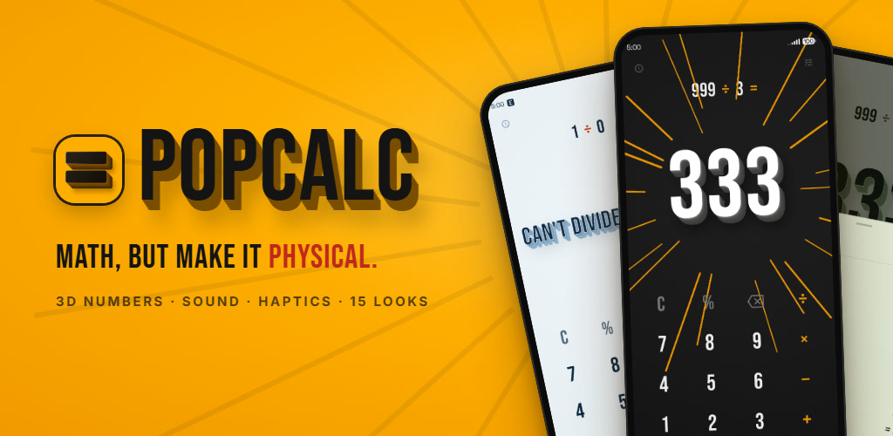
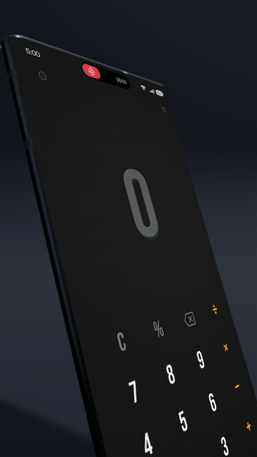
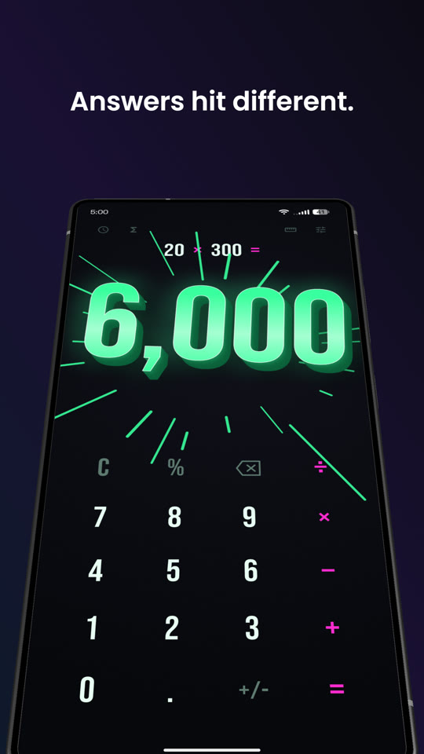
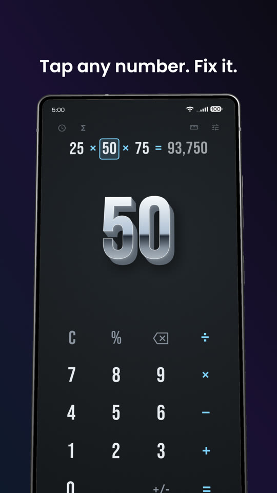
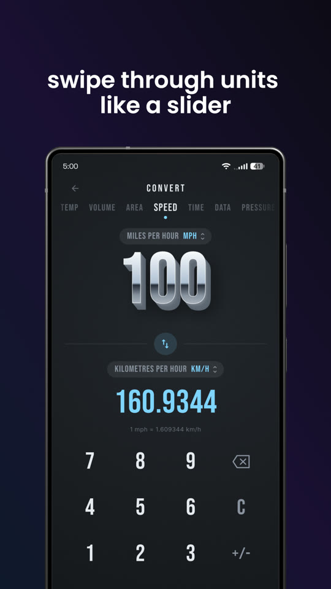
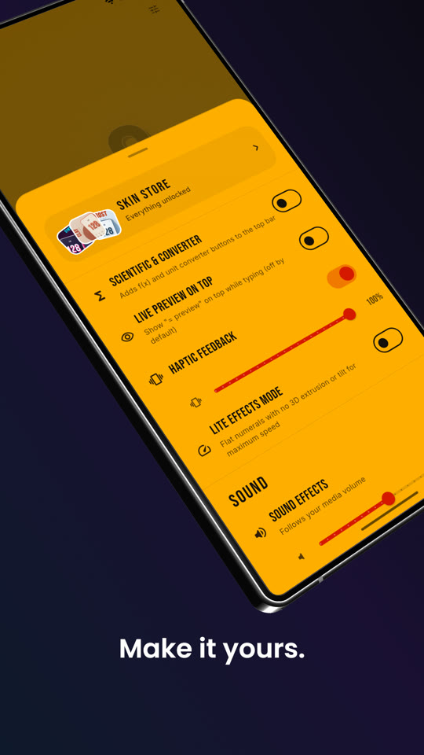
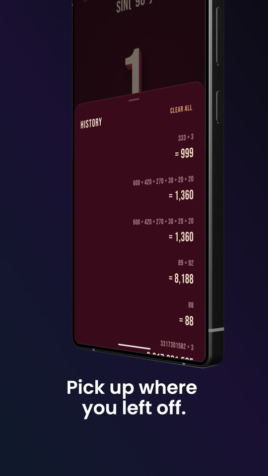

# PopCalc



**Math, but make it physical.**

PopCalc is an Android calculator with sculpted 3D numerals, tactile haptics, musical sound effects, hand-crafted skins, materials, two limited-edition drops with hidden scenes, a live currency converter and one secret skin you have to earn.

- Version: 1.6.0
- Platform: Android
- Built with: Flutter
- Works 100% offline, no ads, no account, zero data collected (go online only if you want live currency rates)

---

## Demo

<p align="center">
  <a href="https://youtu.be/_CBeq_N5ziE">
    
  </a>
  <br/>
  <a href="https://youtu.be/_CBeq_N5ziE">▶ Watch the launch video on YouTube</a>
</p>

<p align="center">
  
</p>

---

## Screenshots

<table>
  <tr>
    <td></td>
    <td></td>
    <td></td>
  </tr>
  <tr>
    <td></td>
    <td></td>
    <td></td>
  </tr>
</table>

---

## Features

### 3D numerals and motion
- Extruded 3D numerals with bevelled edges, soft shadows and a subtle grain texture
- Tilt the phone or drag the number to shift it in 3D
- Each new digit turns into place as you type, with no jumping around
- A speed-line burst when the answer lands

### Haptics
- Native Android haptics with a different feel for each key type
- Heavier feedback on errors
- Adjustable haptic strength

### Sound
- Three sound packs: Pop, Mellow and Typewriter
- Number keys play a pentatonic melody as you type
- Sound only where it matters; everything else is haptics
- Plays alongside your music without pausing it

### Math
- Exact decimal arithmetic, so `0.1 + 0.2 = 0.3`
- Live preview of the answer while you type
- Tap any number or operator in the expression to edit it, and the answer updates instantly; backspace trims a selected number one digit at a time
- Big powers stay fast, so compound interest like `(1 + 0.055 ÷ 365)^365` answers instantly
- History restores the full expression so you can keep editing

### Scientific & Converter
- One switch in Settings adds two buttons to the top bar
- **Scientific:** powers, roots, brackets, trig (DEG/RAD), logs, π, e and factorial, in a tray that folds away. Switch between simple and scientific with one tap
- **Currency converter:** 33 currencies, first in the converter. Works offline with rates built into the app; tap the rates pill to fetch today's rates from the internet whenever you like. Flags, currency signs, money-style rounding
- **Unit converter:** ten more categories with exact factors, on its own screen. Swipe through units and categories like a slider. Data units show both families side by side: decimal (1 GB = 1000 MB) and binary (1 GiB = 1024 MiB), plus bits for internet speeds

### Quick Settings tile
- Add a PopCalc tile to the pull-down Quick Settings panel (Settings → Quick Settings Tile) and open the calculator from anywhere with one tap

### Make it yours
- Eight home-screen icons to choose from in Settings, free for everyone (the official logo stays the default)
- A secret skin, Newsprint, earned by cracking the editor's confidential case: five riddles, each hiding somewhere in the app. Tap the ??? skin in Settings to open the file
- Errors are written as jokes, with the plain reason underneath. Results too big to show get a "that's what she said" all of their own

### Privacy and performance
- Works fully offline; nothing you type ever leaves your phone. The only optional online feature is fetching live currency rates, and it sends nothing about you
- No ads, no account, no data collected
- Lite Effects mode for low-end devices

---

## Skins

Each skin restyles the whole app: numerals, keys, sheets, celebration and status bar.

| Skin | Style | Background | Accent | Tier |
|---|---|---|---|---|
| Charcoal | Dark, white numerals, amber operators | `#141414` | `#FFA000` | Free |
| Marigold | Sunny gold and vermilion | `#FFAE00` | `#D61800` | Free |
| Blueprint | Cyanotype paper, hollow line-drawn numerals | `#0B3C8C` | `#FFD23F` | Free |
| Matcha | Sage paper, ink and terracotta | `#DDE4D0` | `#A8431F` | Pro |
| Frost | Nordic ice, navy numerals | `#E8EFF5` | `#BF360C` | Pro |
| Velvet | Deep wine, cream and rose gold | `#3A0A1B` | `#E8A87C` | Pro |

**Limited drops** (until 11 January 2027): **Mirage**, living dunes under a sky that follows your clock, and **Reckoning**, a doomsday clock on your phone's own time. Each has its own film-style sounds, haptics and a hidden scene to find. $2.99 each or both in the **Dunesday bundle** for $4.99; yours for good once bought.

Pro skins and the five materials (Chrome, Glass, Wood, Neon, Mechanical: a look with its own sound and haptics) are one-time purchases through Google Play, singly or all together in the Everything bundle. Nothing needed to do math will ever be locked.

---

## Get it

PopCalc is on Google Play: https://play.google.com/store/apps/details?id=com.ornobaadi.popcalc

Feedback and feature ideas are welcome in [Issues](https://github.com/ornobaadi/PopCalc/issues).

---

## How the math works

### Order of operations

Multiply and divide come before add and subtract. Operations at the same level run left to right.

```
1 + 2 × 3   →   7
8 ÷ 4 + 2   →   4
```

### Percent

| Input | Meaning | Example | Result |
|---|---|---|---|
| `a + b%` | `a + (a × b / 100)` | `1024 + 5%` | `1075.2` |
| `a − b%` | `a − (a × b / 100)` | `200 − 15%` | `170` |
| `a × b%` | `a × (b / 100)` | `80 × 25%` | `20` |
| `a ÷ b%` | `a ÷ (b / 100)` | `50 ÷ 25%` | `200` |
| `b%` | `b / 100` | `12%` | `0.12` |
| `a% ± b%` | percentages add | `50% + 10%` | `0.6` |

### Edge cases

| Case | Behaviour |
|---|---|
| Divide by zero | Shows a joke ("CAN'T DIVIDE BY ZERO" and friends) with the plain reason underneath; the expression stays editable |
| Consecutive operators | The latest operator replaces the previous one |
| Leading zeros | `007` becomes `7` |
| Very large results | Scientific notation beyond 15 significant digits |
| Trailing zeros | `2.50` shows as `2.5` |
| Repeated `=` | Ignored, so no duplicate history entries |

---

## Project structure

```
lib/
├── core/
│   ├── engine/      # Pure-Dart math: Expression, Parser, Evaluator, Formatter
│   ├── app_icon/    # Home-screen icon choices (Android launcher aliases)
│   ├── audio/       # Sound packs (flutter_soloud)
│   ├── haptics/     # Native Android haptics via MethodChannel
│   ├── storage/     # Settings and history
│   └── theme/       # Skin colour tokens
└── features/
    ├── calculator/  # Controller, 3D numeral painter, keypad, animations
    ├── history/     # History sheet
    ├── settings/    # Skin picker and preferences
    └── splash/
```

- State management: Riverpod
- Math: `decimal` package, with no Flutter imports in the engine
- Sounds are generated by `tool/generate_sounds.py`
- Alternate launcher icons are generated by `tool/generate_app_icons.py`

---

## Build from source

```bash
flutter pub get
flutter test
flutter run
```

Release builds:

```bash
flutter build appbundle --release
flutter build apk --release
```

---

## Platform

| | |
|---|---|
| Android | Supported |
| iOS | Planned |
| Orientation | Portrait (scientific mode can rotate to landscape) |
| Network | None |
| Data collected | None ([privacy policy](docs/privacy-policy.html)) |

---

## License

- App source: MIT
- Fonts: Antonio and Bebas Neue, SIL Open Font License ([Antonio licence](assets/licenses/Antonio-OFL.txt))
- Sounds: procedurally generated, original to PopCalc

PopCalc is not affiliated with Google, Apple or Casio.
